# VotaAí Backend API

API robusta e segura para o ecossistema de votação eletrônica **VotaAí**, construída com **Python 3.12+** e **Django 5.2**, seguindo os princípios de **Domain-Driven Design (DDD)** e **Clean Architecture**.

O sistema implementa criptografia de ponta a ponta (E2EE), integração com módulos de segurança em hardware (**TPM 2.0 / Secure Element** no servidor e **Android KeyStore / StrongBox** nos smartphones eleitores), garantia matemática de anonimato do voto (quebra de correlação com a identidade) e autenticação de administradores vinculada a máquinas físicas 1:1.

---

## ✨ Endpoints da API

### 🖥️ Administração e Autenticação (Desktop)
- `POST /api/admin/pre-registration/start/` — Inicia o pré-cadastro do administrador vinculando máquina física e gerando segredo TOTP
- `POST /api/admin/pre-registration/confirm/` — Confirma o pré-cadastro com código TOTP e assinatura de hardware da máquina
- `POST /api/auth/login/` — Autentica o administrador com 2FA (TOTP) e verificação estrita de assinatura de hardware TPM

### 🗳️ Gestão de Eleições (Desktop)
- `POST /api/election/create/` — Cadastra uma nova eleição com cédula, perguntas, opções e colégio eleitoral
- `POST /api/election/available/` — Lista as eleições criadas e disponíveis para serem iniciadas pela máquina vinculada
- `POST /api/election/start/` — Inicia a eleição, valida a chave criptográfica e despacha tokens únicos de votação por e-mail
- `POST /api/election/close/` — Encerra o período de votação de uma eleição ativa (STARTED), congelando o quórum de votantes e bloqueando novos votos mediante assinatura de hardware da eleição e da máquina

### 🌐 Acompanhamento Público e Monitoramento de Quórum (Público / Mobile / Web)
- `GET /api/election/public/open/` ou `GET /api/public/elections/` — Lista todas as eleições a partir do status de iniciada (`STARTED`, `CLOSED`, `TALLIED`) com dados essenciais, datas (`start_datetime`, `end_datetime`) e métricas de quórum percentual
- `GET /api/election/track/<int:id>/` ou `GET /api/public/elections/<int:id>/` — Acompanha uma eleição específica, exibindo datas de início e finalização, quórum em tempo real ou congelado (`STARTED` / `CLOSED`), porcentagem de quórum e participantes do colegiado eleitoral (indicando `(Ausente)` para quem não votou quando a eleição for encerrada)

### 🌐 Cédula Web e Landing Page (Web / QR Code)
- `GET /votar/` ou `GET /votar/<str:token>/` — Exibe a página com QR Code seguro anti-cache e suporta validação assíncrona (`?check=1`)

### 📱 Processo de Votação (Mobile App)
- `POST /api/vote/request/` — Valida token, atesta integridade de hardware via Android KeyStore (StrongBox/TEE), vincula o dispositivo e entrega a cédula eleitoral cifrada
- `POST /api/vote/cast/` — Valida binding de hardware estrito, quebra a correlação de identidade, deposita o voto anônimo na urna e emite o comprovante eleitoral

### 🔬 Testes e Diagnóstico
- `POST /api/ping-desktop/` — Rota de teste para validação da criptografia de hardware do Desktop (através do `SEDecryptMiddleware`)

### 📖 Documentação da API
- `GET /api/docs/` — Swagger UI interativo
- `GET /api/redoc/` — Interface de documentação ReDoc
- `GET /api/schema/` — Schema OpenAPI 3.0 (YAML/JSON)

---

## 📊 Diagramas das Ações da API

Abaixo estão detalhados os diagramas de sequência de cada ação e fluxo do sistema, ilustrando a comunicação entre os clientes (Desktop, Mobile, Web), o middleware criptográfico, os serviços de hardware (TPM 2.0 e Android StrongBox) e a camada de domínio e persistência.

---

### 0. Camada de Transporte Criptográfico Seguro (`SEDecryptMiddleware`)

Todas as requisições (`POST`, `PUT`, `PATCH`) para rotas protegidas trafegam através de um envelope criptográfico híbrido (**AES-256-GCM** para o payload e **RSA** para a chave simétrica). O `SEDecryptMiddleware` intercepta o tráfego, decodifica a chave simétrica usando o chip **TPM 2.0** do servidor e cifra a resposta com a chave pública da máquina cliente.

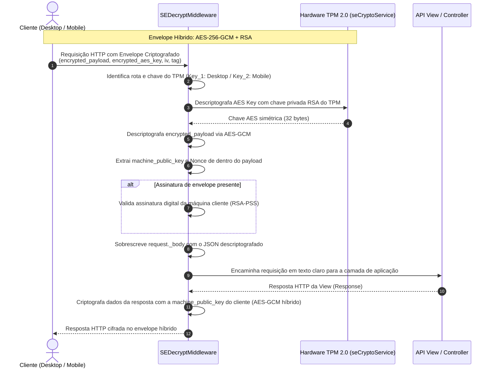

---

### 1. Teste de Hardware Desktop (`POST /api/ping-desktop/`)

Valida a integridade do canal criptográfico entre a aplicação Desktop e o hardware TPM 2.0 do servidor.

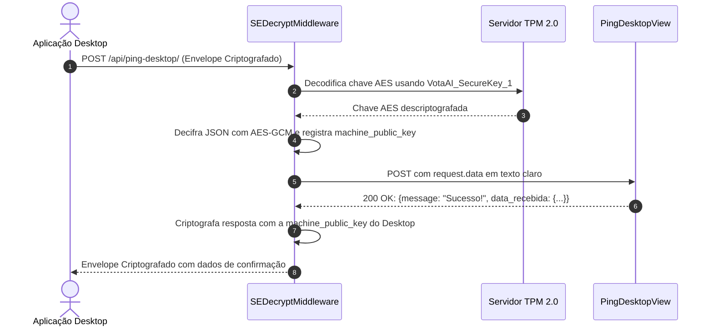

---

### 2. Iniciar Pré-Cadastro de Administrador (`POST /api/admin/pre-registration/start/`)

Inicia a vinculação estrita 1:1 de um usuário administrador a uma máquina física autorizada, criando o cadastro pendente e gerando o segredo 2FA (TOTP).

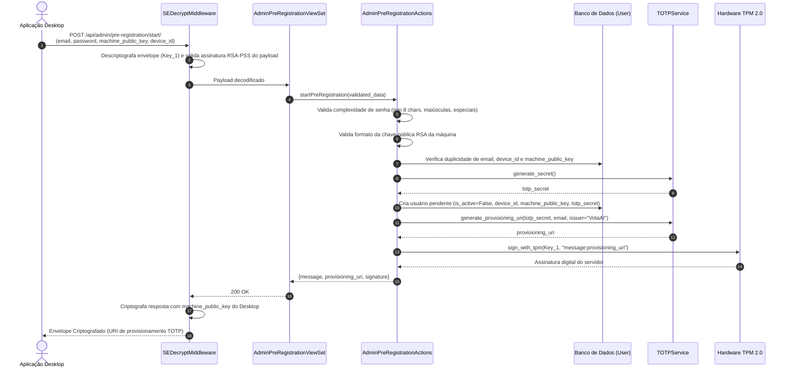

---

### 3. Confirmar Pré-Cadastro com TOTP & Assinatura TPM (`POST /api/admin/pre-registration/confirm/`)

Conclui a ativação do usuário administrador mediante a verificação simultânea da assinatura digital gerada pelo hardware da máquina física e do token 2FA (TOTP).

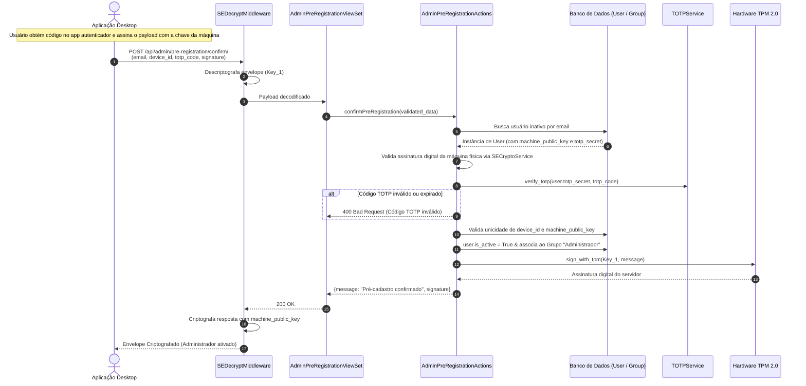

---

### 4. Autenticação Desktop / Login com 2FA & Machine Binding (`POST /api/auth/login/`)

Realiza o login administrativo exigindo credenciais, verificação 2FA (TOTP) e validação matemática de que a requisição partiu da máquina física previamente vinculada.

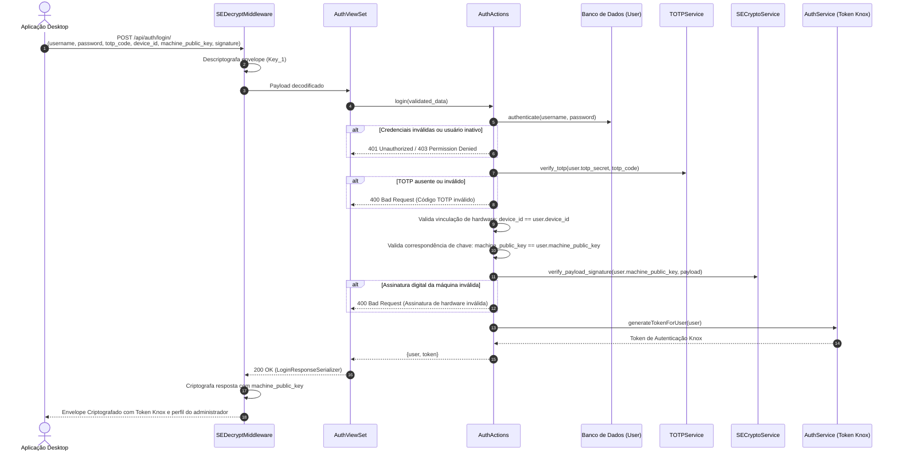

---

### 5. Cadastrar Nova Eleição (`POST /api/election/create/`)

Cria atomicamente as entidades relacionais da eleição (Cédula, Perguntas, Opções e Colégio Eleitoral), validando a assinatura de hardware da máquina criadora e gerando assinatura digital de resposta via TPM.

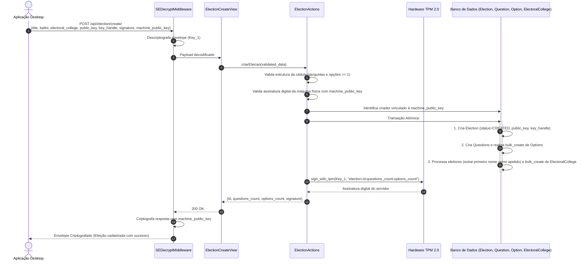

---

### 6. Listar Eleições Disponíveis para Início (`POST /api/election/available/`)

Permite à máquina física autorizada consultar quais eleições foram cadastradas e estão aptas para abertura oficial.

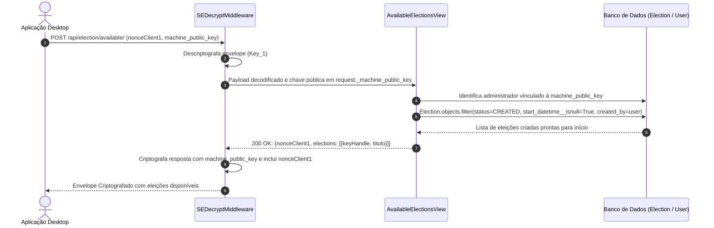

---

### 7. Iniciar Eleição e Despacho de Cédulas (`POST /api/election/start/`)

Valida a chave da eleição, atualiza o status para `STARTED`, assegura as opções padrão ('Branco' e 'Nulo') em todas as perguntas e despacha tokens de uso único criptografados por e-mail para todos os eleitores.

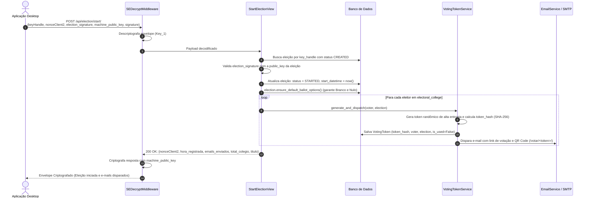

---

### 8. Fechar Eleição e Congelamento de Quórum (`POST /api/election/close/`)

Valida a chave e a assinatura digital da eleição produzida pelo chip TPM da máquina administradora vinculada, atualiza o status para `CLOSED`, define `end_datetime` e congela imediatamente o quórum de votantes, rejeitando quaisquer novas solicitações ou depósitos de votos.

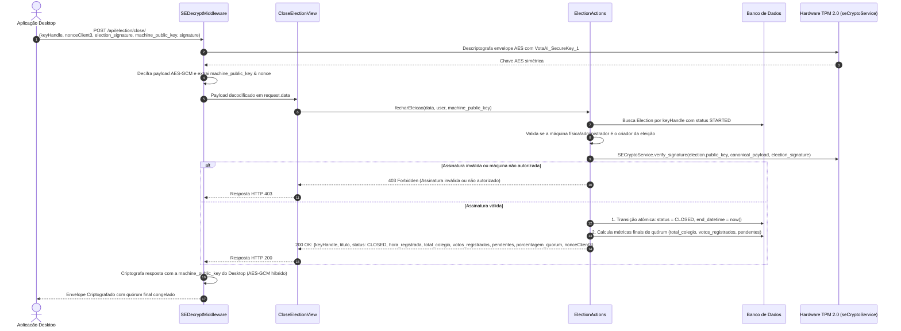

---

### 9. Cédula Web e Landing Page QR Code (`GET /votar/`, `GET /votar/<token>/`)

Landing page que renderiza o QR Code com cabeçalhos anti-cache estritos e criptografia simétrica AES-256-GCM para ser escaneado exclusivamente pelo aplicativo mobile VotaAí.

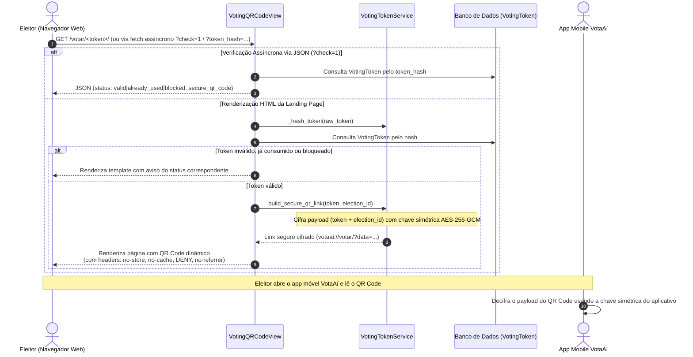

---

### 10. Solicitar Cédula Eleitoral Mobile (`POST /api/vote/request/`)

O aplicativo móvel solicita a cédula de votação apresentando o token de uso único, nonce anti-replay e a cadeia de certificados do **Android KeyStore**. A API exige comprovação de hardware seguro (**TEE ou StrongBox**) antes de vincular a chave do smartphone ao token e emitir a cédula eleitoral.

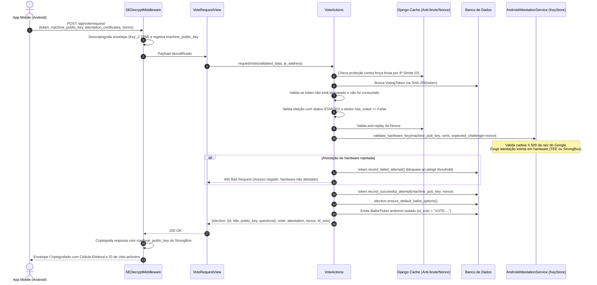

---

### 11. Depositar Cédula Cifrada / Voto Anônimo (`POST /api/vote/cast/`)

O aplicativo móvel cifra as escolhas do eleitor com a chave pública da eleição e assina digitalmente com o chip de hardware. A API realiza o **Hardware Binding Estrito** (garantindo que o voto parta do mesmo dispositivo que solicitou a cédula), quebra completamente a correlação com a identidade do eleitor, deposita o voto anônimo na urna e emite o comprovante eleitoral.

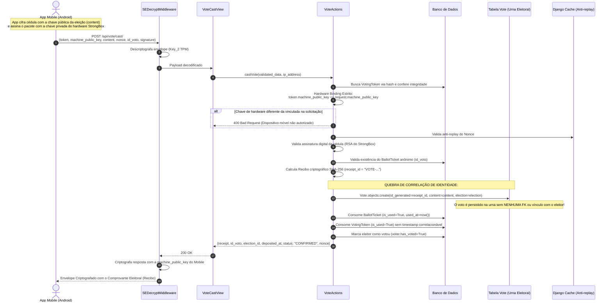

---

### 12. Acompanhamento Público e Monitoramento de Quórum (`GET /api/election/public/open/`, `GET /api/election/track/<id>/`)

Rotas públicas isentas de criptografia de envelope de hardware, permitindo a cidadãos, auditores e aplicativos móveis/web consultar as eleições em andamento e acompanhar o quórum em tempo real. A rota de acompanhamento evolui conforme o ciclo de vida da eleição: exibe quórum dinâmico enquanto `STARTED` e quórum definitivo congelado com data de término (`end_datetime`) quando `CLOSED`. Para eleições encerradas, eleitores que não compareceram à votação são identificados com `(Ausente)` em seu nome. A data de início (`start_datetime`) e a porcentagem de quórum (`quorum_percentage`) são informadas para todas as eleições. Nunca expõe chaves privadas, senhas ou tokens de eleitores.

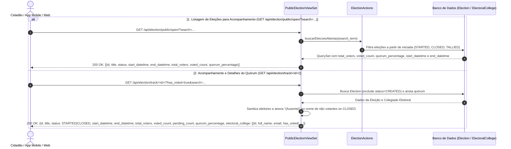

---

## 🏗 Arquitetura

```
Raiz do Projeto
├── Api/            # Camada de Entrada: Views, Serializers, Filtros, Paginação, URLs
├── Controllers/    # Orquestradores: Actions (fluxo de negócio) + QuerySets (abstração ORM)
├── Core/           # Mixins Globais: TimestampSchemaMixin, SlugSchemaMixin, PositionSchemaMixin
├── Domain/         # Camada de Negócio: Models (Schema + Proxy), Signals, Choices, Admin
├── Infrastructure/ # Módulos Externos: Criptografia TPM, Android KeyStore, E-mail, Middlewares
├── media/          # Diretório de uploads de mídia
└── setup/          # Configurações Django: settings, urls, wsgi, asgi
```

### Fluxo de Dados
```
Request → Infrastructure (SEDecryptMiddleware decodifica envelope com TPM)
        → Api (View valida entrada via Serializer)
        → Controller (Action orquestra regras, atestação e criptografia)
        → Domain / Infrastructure (Models interagem com DB; Services com hardware)
        → Controller (retorna dados estruturados)
        → Api (Serializer formata a resposta)
        → Infrastructure (SEDecryptMiddleware cifra resposta com chave pública do cliente)
        → Response
```

### Convenção de Nomenclatura dos Models
- **`XxxProxy`** — Classe base (Mixin). Contém propriedades computadas, regras de negócio e validações RBAC.
- **`Xxx`** — O model Django real (tabela no banco), herdando de `XxxProxy`. Contém campos, relacionamentos e constraints.

---

## 🛠 Stack Tecnológica

| Camada | Tecnologia |
|---|---|
| Linguagem | Python 3.12+ |
| Framework | Django 5.2 + DRF 3.16 |
| Autenticação | django-rest-knox (token-based) + TOTP (pyotp) |
| Criptografia & Hardware | TPM 2.0 (tpm2-tools / TSS2 / Windows CNG) + Cryptography (AES-256-GCM / RSA-PSS) |
| Atestação Mobile | Android KeyStore Hardware Attestation (TEE / StrongBox) |
| Documentação | drf-spectacular (OpenAPI 3.0) |
| Banco de Dados | PostgreSQL 16+ |
| Filtros | django-filter |
| CORS | django-cors-headers |
| Mídia & QR Code | Pillow + qrcode |
| Arquivos Estáticos | WhiteNoise |
| Containerização | Docker + Docker Compose |

---

## 🚀 Início Rápido

### Pré-requisitos
- Docker e Docker Compose
- Chip TPM 2.0 disponível no host (ou emulado)

### Configuração

```bash
# 1. Copie e configure o arquivo de variáveis de ambiente
cp .env.example .env
# Edite o .env se desejar customizar credenciais, nome da API ou senhas iniciais.

# 2. Build e inicialização do projeto
docker-compose up --build -d
```

> ⚡ **Automação via `entrypoint.sh`:**
> Ao rodar `docker-compose up`, o contêiner verifica as variáveis `ENABLE_MIGRATIONS=True` e `ENABLE_SEED=True` no seu `.env` e executa automaticamente:
> - As migrações do banco de dados (`manage.py migrate`);
> - A criação da conta superusuário inicial (`admin` / `admin`);
> - A população de cargos (Groups) e permissões via `seed_dev`;
> - A sincronização dos placeholders de mídia para o volume persistente (`/media`).

API disponível em: `http://localhost:8000/`  
Swagger UI: `http://localhost:8000/api/docs/`  
Django Admin: `http://localhost:8000/admin/`

---

## 🔒 Configuração do Hardware de Segurança (TPM 2.0 / Secure Element)

O projeto utiliza **criptografia baseada em hardware (TPM 2.0)** para operações criptográficas seguras (descriptografia do envelope e assinatura digital).

### 🐧 Configuração no Linux (Ubuntu / Zorin / Debian)

1. **Instale os utilitários do TPM 2.0 no sistema:**
   ```bash
   sudo apt update && sudo apt install -y tpm2-tools
   ```

2. **Permita acesso ao dispositivo do TPM (`/dev/tpmrm0`):**
   ```bash
   sudo usermod -aG tss $USER
   ```
   > 💡 *Para aplicar permissão imediata no terminal atual:*
   > ```bash
   > sudo chmod 666 /dev/tpmrm0
   > ```

3. **Gere as chaves criptográficas no chip TPM:**
   ```bash
   python manage.py generate_se_keys
   ```

---

### 🪟 Configuração no Windows

1. Certifique-se de que o TPM 2.0 está habilitado no Windows Defender / Segurança do Dispositivo.
2. Execute a geração de chaves via PowerShell / CNG:
   ```powershell
   python manage.py generate_se_keys
   ```

As informações das chaves públicas geradas no hardware serão salvas no arquivo `se_keys_info.json`.

---

## 📐 Convenções

- **Commits**: [Conventional Commits](https://www.conventionalcommits.org/)
- **Branches**: feature branches, sem push direto para `main`
- **Migrations**: sempre rode `makemigrations` após alterar models; nunca edite migrations geradas manualmente
- **Signals**: eventos de domínio (signals) ficam em `Domain/signals/`; handlers ficam em `Infrastructure/signals/`
- **Permissões**: codenames em `DomainPermissions`, seed em `group_signals.py`, aplicadas em `Infrastructure/permissions/`

---

Desenvolvido para o sistema de votação eletrônica segura **VotaAí** 🗳️
